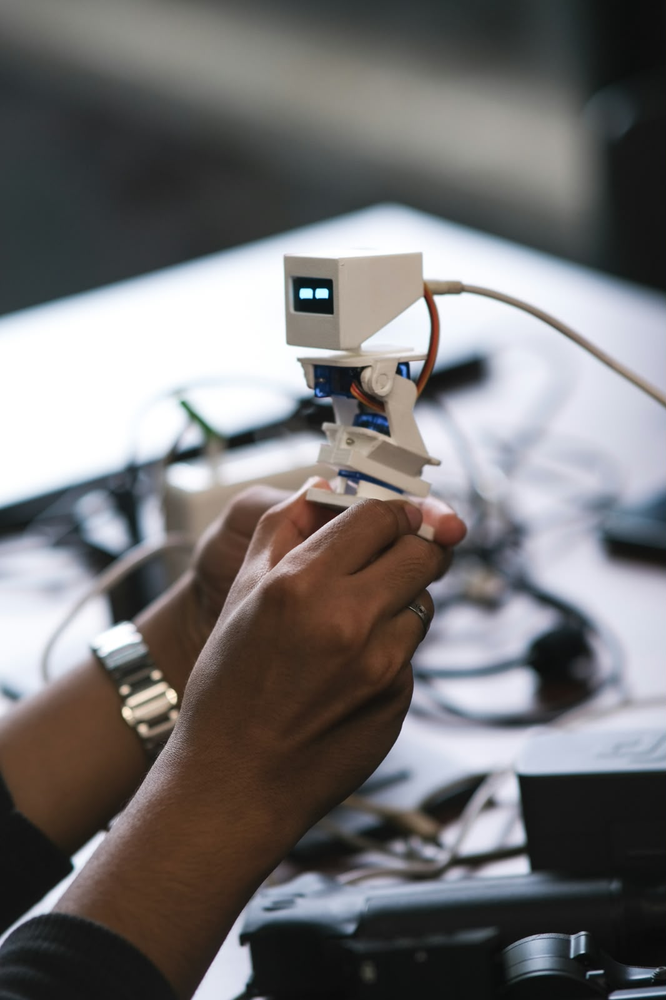
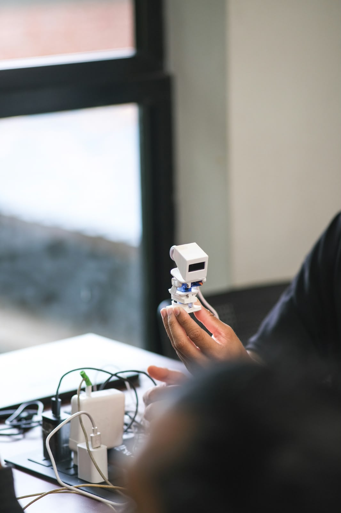

# Desk Buddy

<p align="center">
  
</p>

Desk Buddy is an interactive desktop robot built using an ESP32-C3 Mini. It combines servo-controlled movement, an animated OLED display, multiple expressions and behaviours, automatic operation, and Wi-Fi-based web control.

## Gallery

<p align="center">
  
</p>

## Features

- ESP32-C3 Mini based controller
- Animated eyes using a 128×64 SSD1306 OLED display
- Pan movement using a servo motor
- Tilt movement using a servo motor
- Multiple emotional expressions
- Automatic blinking
- Multiple character moods and behaviours
- Dance and head-dance animations
- Yes and No movements
- Left, Center, and Right positioning
- Automatic random idle behaviour
- Web-based control from a phone or computer
- Wi-Fi connectivity with automatic reconnect
- mDNS support using `deskbuddy.local`

## Expressions and Actions

Desk Buddy supports multiple expressions and movement actions.

| Expression / Action | Description |
|---|---|
| Smile | Displays a happy expression with a small head movement |
| Dance | Moves the base and head together |
| Head Dance | Performs rhythmic head movements |
| Angry | Displays an angry expression with side-to-side movement |
| Sad | Displays a sad expression with a downward movement |
| Surprised | Displays a surprised expression |
| Sleepy | Displays a sleepy expression with downward head movement |
| Love | Displays animated heart-shaped eyes |
| Wink | Displays a winking expression |
| Dizzy | Displays an X-shaped dizzy expression |
| Curious | Looks from side to side |
| Yes | Performs a head-nodding movement |
| No | Performs a head-shaking movement |
| Left | Moves the head toward the left |
| Center | Returns the head to the center position |
| Right | Moves the head toward the right |

## Automatic Mode

Desk Buddy can operate independently using Auto Mode.

When Auto Mode is enabled, the robot automatically selects different idle behaviours and expressions. This allows the robot to perform movements and animations without continuous manual control.

## Web Control

Desk Buddy includes a web-based control interface hosted directly on the ESP32-C3 Mini.

After connecting to the configured Wi-Fi network, the ESP32 displays its IP address on the OLED display. The web interface can then be accessed from a phone or computer connected to the same network.

```text
http://<ESP32-IP>/
```

The device can also be accessed using its mDNS hostname:

```text
http://deskbuddy.local/
```

The web interface provides controls for:

- Triggering expressions
- Controlling robot movements
- Selecting left, center, and right positions
- Controlling the pan position using a slider
- Enabling and disabling Auto Mode

## Hardware

### Main Components

- ESP32-C3 Mini
- 2 × Servo Motors
- SSD1306 128×64 I2C OLED Display
- 5V power supply for the servo motors
- Jumper wires and connectors
- 3D-printed mechanical body

### Pin Configuration

| Component | ESP32-C3 GPIO |
|---|---:|
| Pan Servo | GPIO 1 |
| Tilt Servo | GPIO 2 |
| OLED SDA | GPIO 8 |
| OLED SCL | GPIO 9 |
| OLED I2C Address | `0x3C` |

## Software and Libraries

The project is developed using Arduino IDE.

### Required Libraries

- `Adafruit SSD1306`
- `Adafruit GFX`
- `ESP32Servo`

The project also uses the ESP32 libraries and APIs for:

- Wi-Fi connectivity
- Web Server
- mDNS
- I2C communication

## How It Works

The ESP32-C3 Mini acts as the main controller for Desk Buddy.

```text
                 +-----------------+
                 |   ESP32-C3 Mini |
                 |                 |
                 |  Main Control   |
                 +--------+--------+
                          |
             +------------+------------+
             |            |            |
             v            v            v
        Pan Servo     Tilt Servo    OLED Display
             |            |            |
             +------------+------------+
                          |
                          v
                  Wi-Fi Web Control
                          |
                    Phone / Computer
```

The ESP32 controls the servo positions while simultaneously rendering animated eyes on the OLED display.

The eye animations can change according to the selected expression or mood. The robot also supports automatic blinking, smooth servo movement, and autonomous behaviour.

## Getting Started

### 1. Install Arduino IDE

Install Arduino IDE and configure ESP32 board support.

### 2. Install Required Libraries

Install the following libraries through the Arduino IDE Library Manager:

```text
Adafruit SSD1306
Adafruit GFX
ESP32Servo
```

### 3. Select the Board

Select the ESP32-C3 Mini board in Arduino IDE.

Configure the following option if required by your board setup:

```text
USB CDC On Boot = Enabled
```

### 4. Configure Wi-Fi

In `Firmware/DeskBuddy/`, copy `secrets.example.h` to `secrets.h` and fill in your Wi-Fi details:

```cpp
#define WIFI_SSID_SECRET  "YOUR_WIFI_NAME"
#define WIFI_PASS_SECRET  "YOUR_WIFI_PASSWORD"
```

`secrets.h` is git-ignored, so your real credentials stay off GitHub.

### 5. Upload the Firmware

Connect the ESP32-C3 Mini to your computer and upload the firmware using Arduino IDE.

### 6. Connect to Wi-Fi

After startup, Desk Buddy will attempt to connect to the configured Wi-Fi network.

Once connected, the device displays its IP address on the OLED display.

### 7. Open the Web Controller

Open the displayed IP address in a browser:

```text
http://YOUR-ESP32-IP/
```

Alternatively, if mDNS is available on your network:

```text
http://deskbuddy.local/
```

The web interface can then be used to control Desk Buddy.

## Project Structure

```text
Desk-buddy/
│
├── README.md
├── Firmware/
│   └── DeskBuddy/
│       ├── DeskBuddy.ino        # main sketch (web UI is embedded)
│       └── secrets.example.h    # copy to secrets.h with your Wi-Fi details
├── Circuit Diagram/             # wiring diagram
├── CAD/                         # 3D-printable enclosure and pan/tilt parts
├── deakbuddy.jpeg               # photo (front, eyes)
└── deskbuddy.jpeg               # photo (side)
```

## Circuit Diagram

The circuit diagram for Desk Buddy is included in the repository.


## Future Improvements

Planned and potential improvements include:

- Voice interaction
- Sound effects
- AI-based interaction
- Improved mobile web interface
- RGB lighting
- Additional eye animations
- More advanced autonomous behaviour
- Music-reactive movements
- Remote control over the internet
- Smart-home integration
- Improved 3D-printed mechanical design

## Author

**Rahul Raj K**

Desk Buddy is a personal electronics, robotics, and embedded-systems project.

## License

This project is open source. A specific license can be added to the repository as the project develops.
